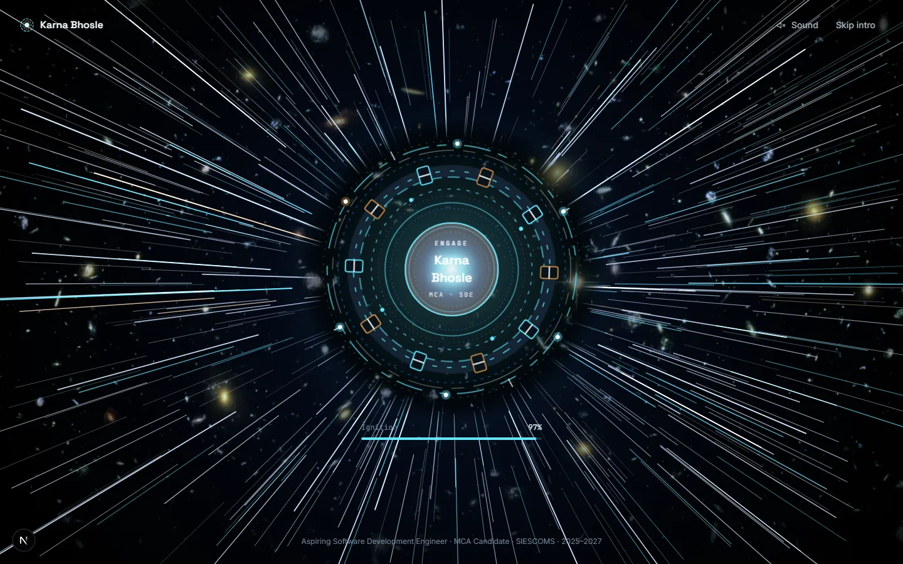
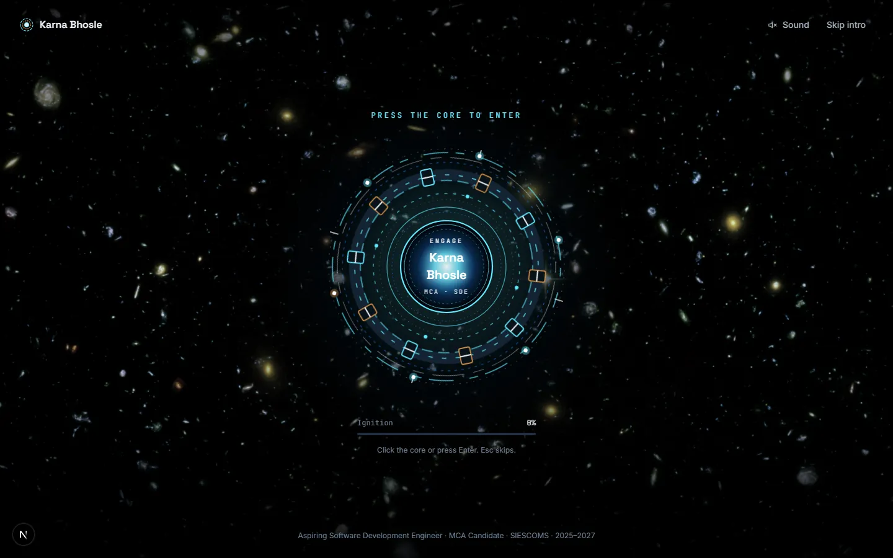
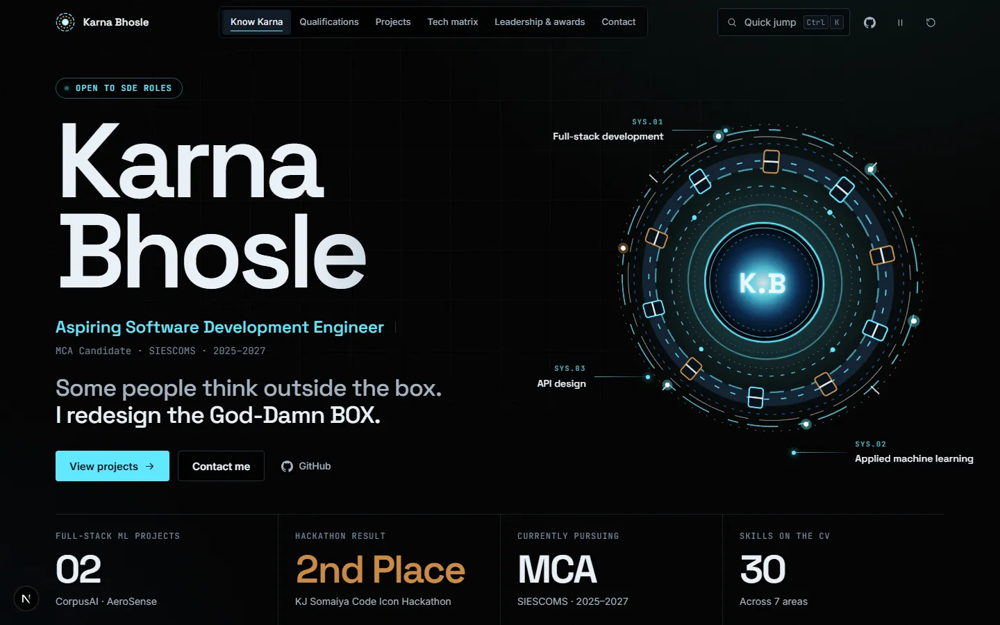
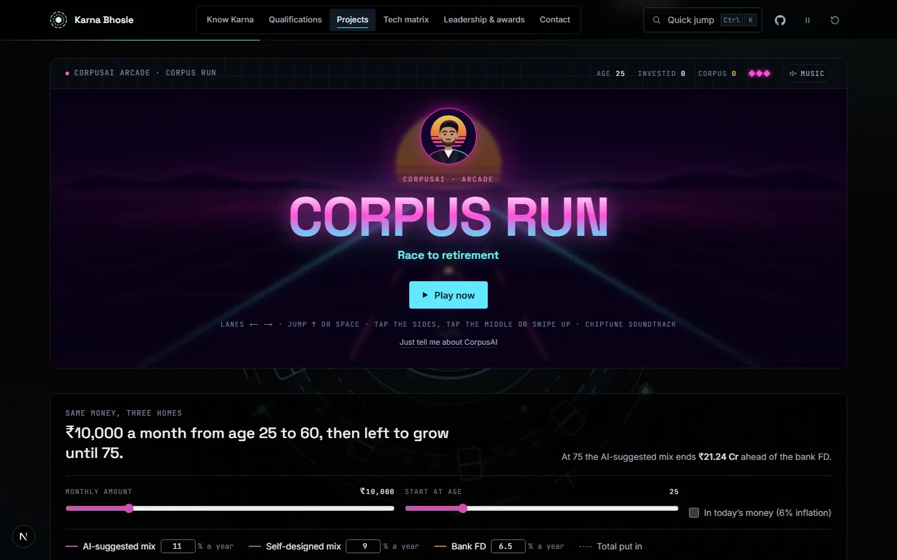
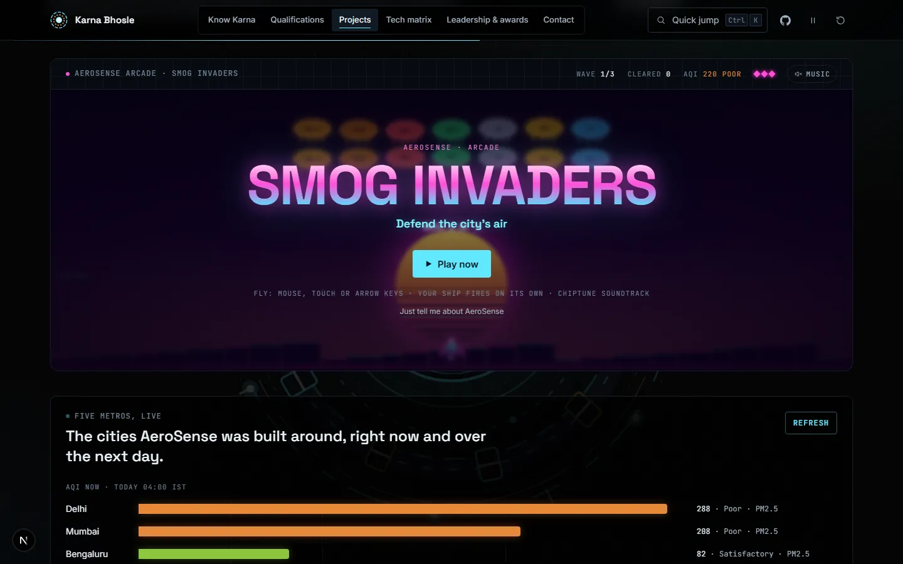
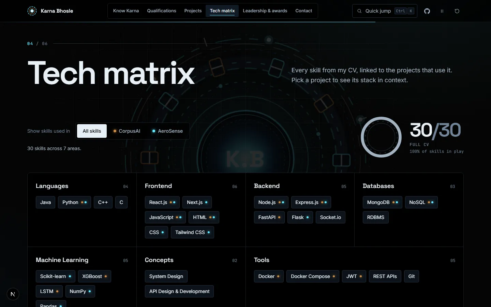
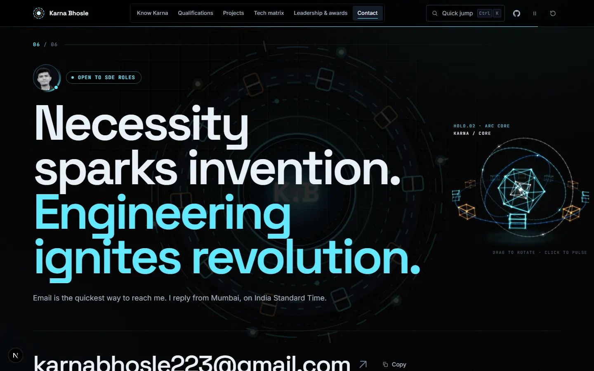
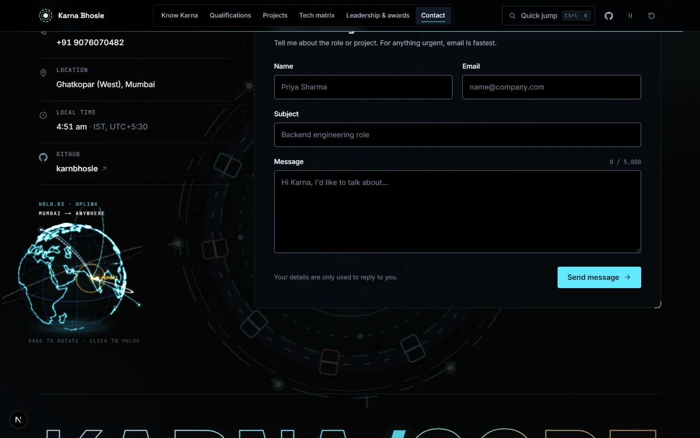
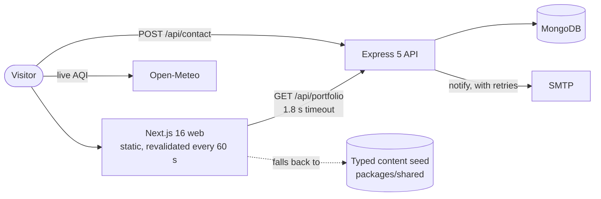

<div align="center">

<a href="https://karnabhosle-portfolio.vercel.app/"></a>

# KARNA / CORE

**Some people think outside the box. I redesign the God-Damn BOX.**

The interactive portfolio of **Karna Bhosle**, aspiring Software Development Engineer (MCA, SIESCOMS 2025–2027).<br>
An arc-reactor ignition, two playable project arcades, live air-quality data and draggable 3D holograms, on a hardened full-stack TypeScript monorepo.

[](https://karnabhosle-portfolio.vercel.app/)


**[Visit the site](https://karnabhosle-portfolio.vercel.app/)** · [Highlights](#highlights) · [Run it locally](#run-it-locally) · [Architecture](#architecture) · [Deploy](#deploy)

</div>

---

## Highlights

| | |
| --- | --- |
| **Arc-reactor ignition** | Press the core: it charges to the repulsor sound, the stars stretch into a warp jump around it, and a faceplate seals and opens onto the portfolio. Skippable, once per session, and calm when motion is reduced. |
| **Playable case studies** | *Corpus Run* (CorpusAI) and *Smog Invaders* (AeroSense) are canvas arcade games whose pieces are the project's real parts, with original chiptune soundtracks synthesised in the browser. |
| **Live data** | AeroSense's charts pull current air quality for five Indian metros from Open-Meteo and map it onto India's CPCB AQI bands. |
| **3D holograms** | A draggable arc core and a world-map globe pinned on Mumbai, rendered by a tiny dependency-free canvas projector. |
| **Hardened contact API** | Express 5 + MongoDB with schema validation, idempotency keys, rate limiting, a honeypot and background email retries. HTTP 201 only after the message is saved. |
| **Accessible by design** | Keyboard paths everywhere, a remembered motion pause, a command palette (Ctrl K), and axe WCAG 2.2 AA scans in the end-to-end suite. |

## Gallery

<table>
  <tr>
    <td width="50%"><br><sub><b>Ignition gate.</b> Press the core to enter.</sub></td>
    <td width="50%"><br><sub><b>Know Karna.</b> The reactor leans toward the pointer and fires on click.</sub></td>
  </tr>
  <tr>
    <td><br><sub><b>Corpus Run.</b> Race to retirement: investments, inflation hurdles, anomalies.</sub></td>
    <td><br><sub><b>Smog Invaders.</b> Defend the city's air, then read the live five-metro AQI.</sub></td>
  </tr>
  <tr>
    <td><br><sub><b>Tech matrix.</b> Every CV skill, linked to the projects that use it.</sub></td>
    <td><br><sub><b>Contact.</b> The arc core hologram, centred on the headline.</sub></td>
  </tr>
  <tr>
    <td colspan="2" align="center"><br><sub><b>Uplink globe.</b> A real world map, pinned on Mumbai, signalling anywhere.</sub></td>
  </tr>
</table>

## Tech stack

| Layer | Tools |
| --- | --- |
| Web | Next.js 16 App Router (Turbopack), React 19 Server Components, Tailwind CSS 3, self-hosted Inter, Space Grotesk and JetBrains Mono |
| Interactivity | Canvas 2D (games, warp field, 3D holograms), Web Audio API (chiptune), CSS scroll-driven and keyframe animation |
| API | Express 5, Mongoose 9, Nodemailer, Helmet, Zod schemas shared with the web app |
| Data | MongoDB 8 / Atlas, with a typed content seed in `packages/shared` as the single source of truth |
| Quality | Strict TypeScript, ESLint 9, Vitest unit and integration tests, Playwright + axe end-to-end tests |
| Hosting | Vercel (web), any long-running Node host such as Render (API), MongoDB Atlas |

## Architecture



The page is a statically generated Server Component. Its server asks the API for content with a short timeout and falls back to the typed seed, so a build never needs MongoDB and the site stays up when the API is down. Small client components handle the intro, navigation, preferences, games, charts, holograms and the contact form.

```text
apps/web          Next.js 16 App Router, React 19, Tailwind CSS 3
apps/api          Express 5, Mongoose 9, Nodemailer
packages/shared   Zod schemas, public types and the canonical content seed
tests/e2e         Playwright browser and axe accessibility tests
tests/helpers     capture.mjs: screenshots of the running site for visual review
docs/screenshots  README images
design/, resources/  Stitch design references (not served)
```

<details>
<summary><b>Everything the front end does, in detail</b></summary>

- **Ignition intro.** Shown once per browser session, skipped for direct section links (`/#projects`) and for crawlers. "Skip intro", Escape, and "Replay intro" in the navigation all work. The page underneath is fully rendered and inert while the intro is up. With JavaScript off, the intro never appears.
- **Motion.** A pre-paint script applies the stored choice, or the OS reduced-motion setting, before anything renders. "Pause motion" stops every decorative loop and is remembered. Reduced motion replaces the ignition with a short cross-fade with no flash. Decorative loops pause while the tab is hidden or offscreen, and the reactor holds still on phones.
- **Layout.** One fixed top bar at every width: inline section links with a live underline from 1024px, a full-screen menu (a native `<dialog>` with focus return) below. A scroll-linked hairline under the bar shows reading progress where the browser supports scroll-driven animations. Layouts are verified at 320, 360, 768 and 1440px and at 200% zoom.
- **Ignition gate background.** The arc reactor sits pinned at the centre of a deep-space field made from `images/Universe.jpg` (the Hubble Ultra Deep Field; credit: NASA, ESA, S. Beckwith (STScI) and the HUDF Team; credited here rather than on the gate). It is exported to `public/images/intro/universe-2560.webp` and `-1440.webp` (about 200 KB and 80 KB), graded toward the site's cyan, vignetted and darkened behind the reactor and text. With motion on it drifts slowly; during the charge a canvas starfield (`components/intro/warp-field.tsx`) stretches into streaks as the photo rushes in and smears, and on the blast it jumps to warp with a blue-white flash.
- **Ignition hand-off (suit-up).** On the blast a red-and-gold faceplate slams shut and seals on the second boom, the visor glowing through its eye slits and a "Systems online" plate that holds until the plates are half open. The whole sequence follows the repulsor clip's own playhead (public/audio/repulsor.mp3), so the blast, the faceplate slam and the hand-off land on its beats even if playback starts late; a stalled clip can hold the visuals back by 400 ms at most. Inside the helmet the HUD boots: corner brackets, a reticle that locks onto the hero reactor, and readouts typing in. Then the plates part onto the portfolio while the hero reactor boots ring by ring. Skipping goes straight to the page.
- **About.** An ID card with Karna's cut-out portrait over the blueprint grid (scanned on hover), focus areas that light up and decode as the pointer crosses them, and the live profile readout.
- **Hero.** The name rises out of a mask as the intro fades. The reactor (with the K.B initials at its core) sits beside it as a live object: it leans toward the pointer, its rings spread and spin faster as the pointer nears, a reticle tracks the pointer, and a click fires a repulsor pulse. It is labelled with the three focus areas. Below it, a proof strip counts projects, the hackathon result, the current degree and CV skills straight from the content.
- **Quick jump.** Ctrl K / ⌘K or `/` opens a command palette (ARIA combobox in a native dialog) to jump to a section, copy the email, call, open GitHub or a repository, or change motion.
- **Qualifications.** Education is drawn as a trajectory chart on a year axis, parsed from each period; the degree in progress is marked as such. A time cursor follows the pointer, a slider (keyboard and screen-reader friendly) or a "Play the journey" run, and reads out where that year falls ("2022 · B.Sc., year 2 of 3").
- **Projects.** Each project is a case study: header and summary, a live service-topology schematic (packets travel the edges only while it is on screen and motion is on), numbered highlights, the processing pipeline, its stack and expandable implementation notes. AeroSense includes an interactive scale of India's CPCB AQI bands; it describes the public standard, not project measurements. Its prediction flow, on its first automatic run and every rerun (or "Read Mumbai now"), spins a light across the bands like a slot machine while Mumbai's current air quality is fetched from [Open-Meteo](https://open-meteo.com/en/docs/air-quality-api) (CC BY 4.0, fixed city coordinates, no visitor data), then lands on the live band. The AQI is estimated from modelled hourly PM2.5, PM10 and NO₂ with CPCB breakpoints and labelled as such; the CSP allows `https://air-quality-api.open-meteo.com` for this.
- **Project games.** Each case study opens with a title screen (game title, a project-tied subtitle, **Play now**) and a canvas arcade game in a neon synthwave look (striped sun, magenta grid, cyan glow) whose pieces are the project's pieces. *Corpus Run: Race to retirement* (CorpusAI) stars a Karna character (swept dark hair, trimmed beard, black suit and white shirt; a front-facing avatar on the title screen) running a three-lane highway from age 25 to 60: coins are investments and the corpus compounds; inflation hurdles can be jumped (↑, Space, tap the middle or swipe up), anomaly pillars must be dodged, and rows are sparse. Hexagon power-ups last five seconds: Shield absorbs a hit, Phase passes through barriers, Magnet pulls coins in. *Smog Invaders: Defend the city's air* (AeroSense) has a ship with momentum that banks into turns and flies anywhere in the lower zone (pointer spring-follow or held arrow keys) while it fires on its own; from wave two invaders break formation and dive, and destroyed invaders drop Spread shot, Shield (five seconds each) or a Purifier pulse. Afterwards, "What you just played" maps each piece to the real system and says which power-ups are game extras; "Just tell me" skips straight to it. Scores are game points, not project measurements.
- **Project charts.** CorpusAI's *Same money, three homes* compares one monthly amount in an AI-suggested mix, a self-designed mix and a bank FD from a chosen start age to 60, then growing untouched to 75, with a slider for the amount and age, editable assumed returns, a today's-money switch, crosshair tooltips, direct labels and a table view. It is labelled as illustrative assumptions, not CorpusAI output or financial advice. AeroSense's *Five metros, live* fetches Delhi, Mumbai, Kolkata, Chennai and Bengaluru (the cities in its dataset) from Open-Meteo in one request when the chart nears the viewport: a bar chart of the AQI now, coloured and labelled by CPCB band, and five small multiples on one scale with a shared crosshair showing today (solid) and the model forecast for tomorrow (dashed). AQI uses CPCB breakpoints on trailing 24-hour means of PM2.5, PM10 and NO₂; the copy says the forecast is Open-Meteo's model, not AeroSense's Random Forest. Chart colours were checked with a colour-blindness validator against the dark surface.
- **Tech matrix.** Every CV skill, grouped as on the CV, with a dot per project that uses it. Choosing a project lights its stack and shows the share of CV skills it covers.
- **Uniform HUD layer.** Section titles decode on view and on hover; training, language, award and leadership cards lean toward the pointer with a glare and HUD corners (large cards lean less); languages flip to a greeting; the hackathon medal turns and its placing catches a sheen; leadership duties light up in sequence; contact channels light up as the pointer crosses them, beside a headshot with a signal ring.
- **Holograms.** Two draggable 3D wireframes are drawn on a dependency-free canvas projector (`components/holo`): the arc core beside the contact headline (midway between the docked background reactor and the page edge, centred on the headline) and an uplink globe under the contact details with Natural Earth coastlines, a gold Mumbai pin and signals arcing out to six cities. Drag to turn them with inertia, click or Enter to pulse, arrow keys to rotate; they idle off-screen and hold still when motion is paused.
- **Chiptune soundtrack.** Each game has an original soundtrack synthesised live with the Web Audio API (`lib/chiptune.ts`): pulse-wave lead, triangle bass and noise drums, with a tempo that rises as the round heats up, plus 8-bit effects for coins, jumps, hits and power-ups. A Music toggle in each game shares the site-wide Sound choice.
- **Footer wordmark.** KARNA/CORE draws itself in as an outline (white to cyan to copper), then a synthwave neon beam (magenta into violet into cyan, with a hot white core) sweeps along it from left to right while it is on screen.
- **Contact.** Client-side validation with the shared schema, inline errors linked to their fields, a saved draft that survives a reload, a honeypot, and honest outcomes for every response: saved (with the real email status), not saved, rate-limited (with the wait time) and unconfirmed. Each message carries an `Idempotency-Key`, so retrying after an unconfirmed send can never save it twice.

</details>

## Run it locally

Requires Node.js **22.12+** (tested on 24.12), npm, and MongoDB 8 or a MongoDB Atlas connection. Docker Desktop is optional. From the repository root:

```powershell
npm ci
Copy-Item apps/api/.env.example apps/api/.env
Copy-Item apps/web/.env.example apps/web/.env.local
docker compose up -d mongo
npm run seed
npm run dev
```

Open **http://localhost:3000**; Express listens at **http://localhost:4000**. `npm run dev` builds and watches the shared package, Next.js and Express together. Stop with Ctrl+C; `docker compose down` stops MongoDB and keeps its `karna_mongo` volume.

**Only want the page?** Run `npm run dev:web`. No API, database, SMTP or credentials are needed to render or build it: content comes from the shared seed, and the contact form says honestly that it cannot save.

**After changing content, run `npm run seed` again.** The API serves the stored database copy, so an older seed in MongoDB keeps showing old content until it is replaced.

<details>
<summary><b>Environment variables</b></summary>

Copy the examples as shown above; real `.env` files are ignored. No secrets belong in `NEXT_PUBLIC_*` variables.

| Variable | Used by | Purpose |
| --- | --- | --- |
| `MONGODB_URI` | Express | Private connection string; local example uses `karna_portfolio`. |
| `HOST`, `PORT` | Express | Defaults `127.0.0.1`, `4000`. For a container, bind `HOST=0.0.0.0` deliberately. |
| `ALLOWED_ORIGINS` | Express | Comma-separated exact browser origins, e.g. `http://localhost:3000`. No wildcard. |
| `TRUST_PROXY` | Express | Exact trusted reverse-proxy hop count. Default `0` for direct local traffic. |
| `SMTP_HOST`, `SMTP_PORT`, `SMTP_SECURE` | Express | SMTP provider connection; commonly 587/false (STARTTLS) or 465/true. |
| `SMTP_USER`, `SMTP_PASS` | Express | Provider credentials; optional for a trusted local relay. |
| `SMTP_FROM` | Express | Fixed provider-approved sender address. |
| `SMTP_TO` | Express | Fixed recipient; defaults to `karnabhosle223@gmail.com`. |
| `NOTIFY_RETRY_INTERVAL_MS` | Express | How often failed notifications are retried; default 5 minutes, `0` disables. |
| `NOTIFY_MAX_ATTEMPTS` | Express | SMTP attempts per message, default 5. |
| `API_BASE_URL` | Next.js server | Internal address of Express for content fetching. |
| `NEXT_PUBLIC_API_BASE_URL` | Browser | Public Express origin for the contact form, also added to the Content-Security-Policy. Baked in at build time; a production build without it tells visitors to email directly. |
| `SITE_URL` | Next.js server/build | Real public origin. Enables the canonical URL, sitemap entry and Person `url`. Leave blank locally. |

</details>

<details>
<summary><b>API reference</b></summary>

| Endpoint | Behaviour |
| --- | --- |
| `GET /api/health/live` | Liveness: 200 whenever the process is serving. |
| `GET /api/health` | Readiness: database and email configuration status; 503 while the database is unavailable. |
| `GET /api/portfolio` | Strict allowlisted content: the database copy when valid, else the canonical seed. Fields added since older content was stored get their defaults. |
| `POST /api/contact` | Validated name, email, subject, message and empty `website` honeypot. Optional `Idempotency-Key` header. |

HTTP 201 is returned **only after MongoDB saves the message**. SMTP is attempted afterwards and its outcome is stored as `pending`, `accepted`, `failed` or `not_configured`; acceptance never claims inbox delivery. A retry with the same `Idempotency-Key` returns the original receipt with `replayed: true` and HTTP 200, without saving or emailing again; reusing a key for a different message returns 409. Failed notifications are retried in the background with backoff (5, 15, 45 and 135 minutes) up to the attempt limit. Claims are atomic, so several API instances never send the same retry twice.

Every response carries an `X-Request-Id`, and server logs are JSON lines with event codes and request IDs, never enquiry text, addresses or credentials. The API also has Helmet, explicit CORS origins, a 32 KB body limit, strict shared schemas, the honeypot and five contact attempts per IP per 15 minutes. The in-memory rate-limit store suits **one API instance**; use a shared store before scaling out. See [API operational details](apps/api/README.md).

</details>

<details>
<summary><b>Content and assets</b></summary>

Edit only `packages/shared/src/seed.ts`, rebuild, and run `npm run seed` against the intended database. The seed is idempotent and **overwrites** the stored `main` content document; it never touches contact messages.

Skills and project descriptions come from Karna's CV and accompanying instructions; the repositories were not audited. Education results (SSC 83%, HSC 83.50%, B.Sc. 7.28 CGPA, MCA pursuing) are shown at Karna's request, in the education `result` field. Invented metrics, unverified outcomes and unprovided social accounts are excluded from schemas, content, metadata and API responses. The GitHub profile link is the account that owns both project repositories. Each project's `pipeline` lists its processing stages with only CV-backed detail. CorpusAI's model-to-stage mapping (XGBoost for risk classification, the dual-head LSTM for net-worth forecasting, K-Means and Isolation Forest for peer grouping and anomalies) follows the previous page copy; confirm it before publishing.

The profile portrait (`/images/profile/karna-portrait.webp`) and the contact headshot are cut-outs prepared from `images/profilepicture.jpeg`, with the paper background removed so they sit on the dark interface. The portrait keeps the name lettering (the red script stays red; the black print is turned light so it reads on dark). The original is not served.

Optional assets use one strict shape and default to `null`:

```ts
{ path: '/images/certificates/code-icon.jpg', alt: 'Accurate description of the certificate', width: 1600, height: 1100 }
```

| Field | Effect when set |
| --- | --- |
| `profile.portrait` | A photo at the top of the Profile panel. |
| `projects[].screenshot` | A screenshot under the project summary. |
| `training[].certificate`, `activities.achievements[].certificate` | A "View certificate" button opening an accessible dialog. |
| `profile.publicResume` | Reserved; leave `null` until a grade-free resume is approved. |

Put files in `apps/web/public/images/projects/`, `apps/web/public/images/certificates/` or `apps/web/public/resume/`, use their **real** dimensions, then reseed and rebuild. Do not publish the original CV; the site carries only what is listed in the seed.

</details>

## Quality checks

```powershell
npm run lint
npm run typecheck
npm test
npm run test:integration
npm run test:e2e
npm run build
npm start
```

- `npm test`: request, idempotency, logging, retry-worker, notification and configuration tests with repository doubles and mocked SMTP.
- `npm run test:integration`: real Mongoose against a temporary MongoDB, covering records, attempt counting, idempotency indexes, atomic retry claims and seeding. It never reads the live database URI. The first run may download a MongoDB test binary; set `MONGOMS_SYSTEM_BINARY` to use an installed one.
- `npm run test:e2e`: starts the frontend and checks the intro, anchors and navigation, the mobile menu, motion and sound preferences, the skill filter, both project games, the CorpusAI growth chart, the five-metro AQI chart (with a mocked feed, including the outage state), the AQI scale, the 404 page, no-JavaScript rendering, every contact-form outcome including idempotent retries, overflow at 320–1440px and 200% zoom, and axe WCAG 2.2 AA scans. Install the browser once if needed: `npx playwright install chromium`.
- `node tests/helpers/capture.mjs http://localhost:3000 360,768,1440`: screenshots for visual review in `test-results/capture`.

See [verification results](VERIFICATION.md) for the checks actually run. No Lighthouse score is claimed.

## Deploy

The site is live at **[karnabhosle-portfolio.vercel.app](https://karnabhosle-portfolio.vercel.app/)**. Follow [the beginner hosting guide](HOSTING_GUIDE.md) for the full Vercel + Render + MongoDB Atlas setup, contact-form verification and troubleshooting.

**Web on Vercel.** Import the repository with **Root Directory** `apps/web`. [`apps/web/vercel.json`](apps/web/vercel.json) installs from the monorepo root with `npm ci --include=dev` and runs the workspace build. Set `API_BASE_URL` and the public HTTPS `NEXT_PUBLIC_API_BASE_URL` **before building**. Production builds on Vercel use `https://karnabhosle-portfolio.vercel.app` as the canonical URL unless `SITE_URL` overrides it. Production responses carry a Content-Security-Policy, HSTS, `X-Frame-Options: DENY` and related headers.

**API on a Node host.** Run `npm ci` from the root lockfile, build shared and API, then `npm run start -w @karna/api`. Configure the database, SMTP, `ALLOWED_ORIGINS` and proxy trust deliberately, and serve it over HTTPS. Point liveness checks at `/api/health/live` and readiness at `/api/health`.

**Database.** Use a private MongoDB with a least-privilege application user, backups, and a retention policy for contact messages. Seed it from the same content version, then confirm health, content and one real submission, and check the stored notification status.

## Credits and licences

- Ignition background: the Hubble Ultra Deep Field. Credit: NASA, ESA, S. Beckwith (STScI) and the HUDF Team.
- Globe coastlines: [Natural Earth](https://www.naturalearthdata.com/) 1:110m land (public domain), via [world-atlas](https://github.com/topojson/world-atlas).
- Live air quality: [Open-Meteo Air Quality API](https://open-meteo.com/en/docs/air-quality-api) (CC BY 4.0).
- Fonts: Inter, Space Grotesk and JetBrains Mono under the SIL Open Font License; see `apps/web/src/app/fonts/`.
- Game music and sound effects are original and synthesised in the browser; nothing is sampled.
- The intro sound (`apps/web/public/audio/repulsor.mp3`) is a film sound-effect clip. Confirm you have the right to use it publicly, or swap in a licensed sound.

ESLint 9 is pinned because the current Next.js React lint plugin fails with ESLint 10.

## Contact

**Karna Bhosle** · Mumbai, India<br>
[Portfolio](https://karnabhosle-portfolio.vercel.app/) · [GitHub @karnbhosle](https://github.com/karnbhosle) · [karnabhosle223@gmail.com](mailto:karnabhosle223@gmail.com)

<br>

<div align="center"><sub>Necessity sparks invention. Engineering ignites revolution.</sub></div>
